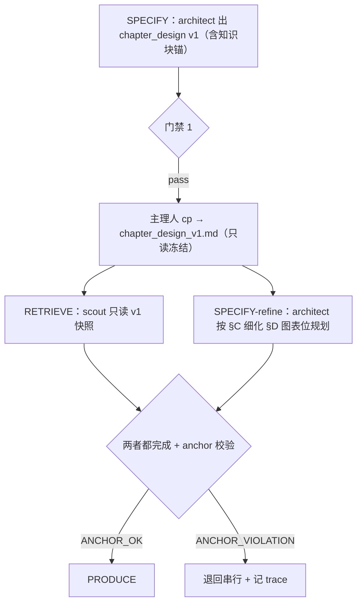
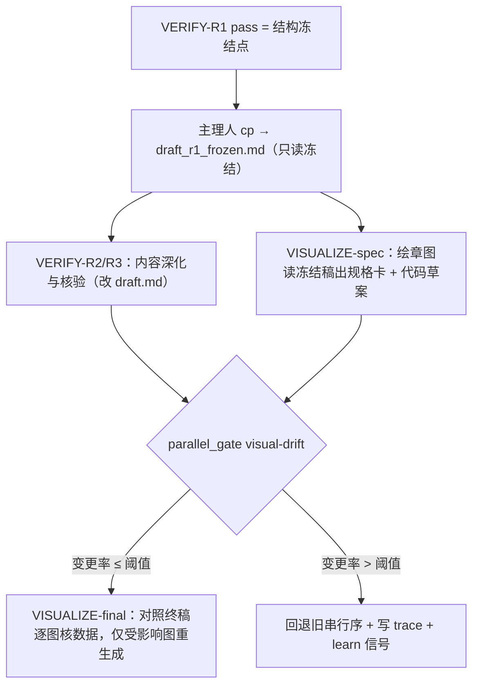
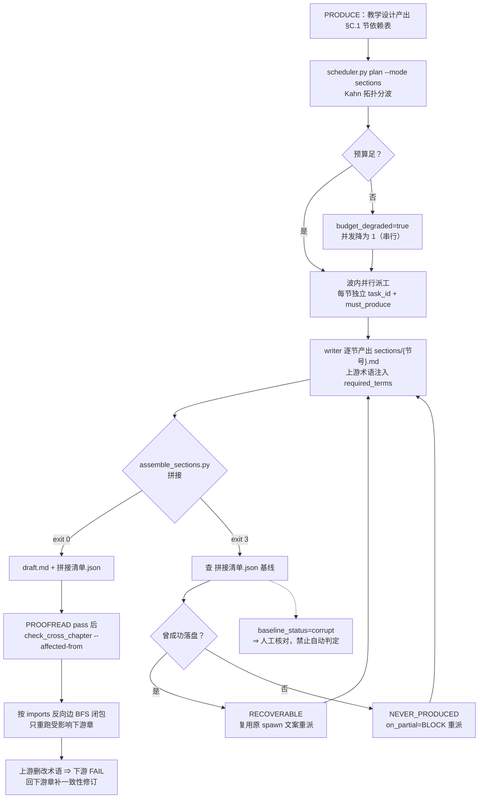

# textbook-pipeline-workflow — 13 态教材编写流水线

> 转换自 content-forge v5 `schemas/state_machine_v2.yaml`（13 态 SSOT）。本 skill 是团队编排的权威流程参考，主理人与成员按需加载。

## 何时使用

- 启动/推进任一章节编写流程（W1 全流程）
- 判断当前处于哪个状态、下一步允许去哪
- 门禁不通过时决定返工目标
- 跨阶段交接时核对 handoff 契约

## 工作根目录约定（WORK_ROOT）

**所有路径相对 WORK_ROOT，由主理人在 CLARIFY 阶段确定并写入每个成员的任务指令。成员一律不猜路径；未收到 WORK_ROOT 的成员应回问主理人而非自行假设。**

```
{WORK_ROOT}/
├── 章节/{ch##}/
│   ├── chapter_design.md          # 教学设计（didactic-architect；refine 版）
│   ├── chapter_design_v1.md       # 门禁 1 通过时的 v1 快照（主理人 cp，B3 共享锚基准）
│   ├── sections/{节号}.md         # 节级正文（subject-writer）——大章节强制（批次 C4）
│   ├── draft.md                   # 章节正文（由 sections/ 拼接，subject-writer）
│   ├── draft_r1_frozen.md         # VERIFY-R1 pass 时的结构冻结稿❄（主理人 cp，B3）
│   ├── review/round{N}_report.md  # 审查报告（quality-examiner）
│   │   ├── r3_verification_log.md # 引用核验明细 → 溯源表来源（build --assemble 自动转写）
│   │   ├── proofread.md           # 校对后稿（R4 修订标记版，quality-examiner；v1.1.0）
│   │   └── proofread_revisions.md # 修订记录+结论行（ASSEMBLE 转写校稿结论节；v1.1.0）
│   └── figures/{图号}.md          # 图表代码（visual-instructional-designer）
│       └── assets/{图号}.ipynb    # 数据图的原始数据+绘图代码（批次 C5）
├── 知识库/retrieval/
│   ├── {ch##}_{英文slug}.md       # 检索摘要（literature-scout）
│   └── RETRIEVED.md               # 知识沉淀库（append，缓存优先来源）
├── 运行态/                        # 黑板 / trace / 进度 / 动态成员注册表
│   ├── workflow-state.yaml        # 状态黑板 SSOT
│   ├── progress.md                # 续跑检查点（progress.py）
│   ├── trace.jsonl                # 每次成员调用一行
│   ├── knowledge_anchor_{ch##}.json   # B3 锚校验报告（含 baseline_ids，门禁 2 读它）
│   ├── visual_drift_{ch##}.json       # B3 图表位漂移决策报告（含 learn_signal）
│   ├── section_recovery_{ch##}.json   # B4 缺节恢复报告（RECOVERABLE / NEVER_PRODUCED）
│   ├── dynamic-members.yaml       # 动态成员注册表（confirmed_by_user: true 才生效）
│   └── team-proposal-{ch##}.yaml  # 动态团队提案（未确认前不生效）
├── 学习/候补/{日期}_{ch##}_候补.yaml   # LEARN 候补池（≥3 候选或用户 ack 才合并）
└── 交付/
    ├── {教材名}_{ch##}.md         # 书稿【源格式】（主理人装配；唯一编辑入口；承载修订标记 §1.5）
    ├── {教材名}_{ch##}.docx       # 书稿【交付格式】（由 md 生成；Word 修订态审改后须回流 --apply-revisions）
    ├── {教材名}_{ch##}_审阅.docx  # 审阅版（--revisions：修订标记→Word 真修订；v1.1.0）
    └── {教材名}_{ch##}.溯源.md     # 溯源表（build --assemble 自动生成；判据 4.12；v1.1.0）
```

> **交付形态（2026-10-30 修订）**：交付物是**大学教材书稿**，`.md` 为源、`.docx` 为交付格式。
> 规格 SSOT = `skills/manuscript-delivery/SKILL.md`；构建 = `scripts/build_manuscript.py`；
> 校验 = `scripts/check_manuscript.py`（门禁 4）。
> 原目录树只有 `.md` 一档，docx 长期只是「按需转」的软承诺且无实现（实测包内 0 命中 docx）。
>
> **目录树补全（批次 C4/C3，2026-10-30）**：此前本树只有 3 支（章节/知识库/交付），
> 而 `运行态/`（6 份 skill 引用）与 `学习/候补/`（learn-protocol 引用）**从未进过目录树**——
> 目录树是 WORK_ROOT 的 SSOT，缺支 = 成员按 SSOT 找不到运行态文件。
> 另：`sections/`（节级正文）、`assets/*.ipynb`（数据图代码）、`*.溯源.md`（溯源表）为新增支。
>
> **B3 新增四支（2026-11-04 搭接并行）**：`chapter_design_v1.md` / `draft_r1_frozen.md`
> 是**只读冻结快照**（主理人 cp 一次后禁改），分别给 scout 与绘章图当并行基准；
> `运行态/knowledge_anchor_{ch##}.json` / `visual_drift_{ch##}.json` 是
> `scripts/parallel_gate.py` 的两份决策报告。详见 §搭接并行协议。

命名规则：章节号两位数字（`ch01`）；topic 用英文小写连字符 slug；图按 `图 {章}-{序}` 编号；
节号沿用教学设计的节号（如 `1.1`，落盘为 `sections/1.1.md`）。

## 13 态状态机

> **相位枚举的唯一权威 = `scripts/progress.py` 的 `PHASE_ORDER`（23 相位 = 5 个 `BOOK_*` 全书相位 + 18 个章域相位，章域含 R1-R5 子轮次）。**
> 本节是**业务视图**（13 个粗粒度态），不构成第二份枚举：`PRODUCE`/`VERIFY`/`PROOFREAD`
> 在脚本里是粗粒度别名，分别落到 `PRODUCE-R3`/`VERIFY-R3`/`PROOFREAD-R5` 行。
> 两处对不上时以 `PHASE_ORDER` 为准，并由 `scripts/check_phase_consistency.py` 机械拦截（ADR-04）。

```
BOOTSTRAP → INTAKE → CLARIFY → SPECIFY → RETRIEVE → PRODUCE → VERIFY
  → PROOFREAD → CONSOLIDATION → VISUALIZE → ASSEMBLE → DELIVER → LEARN
```

| 状态 | 职责人 | 产出 | 下一合法态 | 门禁 |
|------|--------|------|-----------|------|
| BOOTSTRAP | 主理人 | 工作目录初始化 | INTAKE/SPECIFY | 目录/规则文件就绪 |
| INTAKE | 主理人 | 材料清单 | CLARIFY/SPECIFY | — |
| CLARIFY | 主理人 | 3 句话需求摘要 | SPECIFY | 关键信息齐全 |
| SPECIFY | didactic-architect | chapter_design.md（v1 快照 + refine 版） | RETRIEVE | 门禁 1：设计覆盖知识域 + 知识块锚区块合法 |
| RETRIEVE | literature-scout | retrieval/{chapter}_*.md | PRODUCE | 门禁 2：覆盖率/冲突率/时效性（覆盖判据按 v1 `baseline_ids`）；**与 SPECIFY-refine 搭接并行** |
| PRODUCE | subject-writer | sections/{节号}.md → draft.md（R1→R2→R3） | VERIFY | **门禁 3**（见下，2026-10-29 补判据） |
| VERIFY | quality-examiner | 审查报告（R1-R3）+ verdict | PROOFREAD / RETRIEVE / PRODUCE | R1-R3 全 pass |
| PROOFREAD | quality-examiner | **R4 校稿**（三件套：`review/proofread.md` 校对后稿·带修订标记 + `review/proofread_revisions.md` 修订记录+结论 → ASSEMBLE 转写「校稿结论」节，判据 4.13c）+ **R5 质量评分**（五维+80 分红线，结果写审查报告「质量评分」段 + progress `PROOFREAD-R5` 行） | CONSOLIDATION | R4 修订标记成对（4.13a）+ 结论已出（4.13c）+ **R5 ≥80 分** |
| CONSOLIDATION | 主理人 | 统稿后全章 | VISUALIZE | 术语/编号一致 |
| VISUALIZE | visual-instructional-designer | 图表代码包（**spec 规格卡草案 + final 终核**两子阶段） | ASSEMBLE | 图文一致（ASSEMBLE 前仍须 visual-review verdict） |
| ASSEMBLE | 主理人 | 装配稿 + docx（md 源 → 双格式） | DELIVER | 组件齐全 + docx 构建成功 |
| DELIVER | 主理人 | 交付物 + 质量报告 | LEARN | **门禁 4 全 pass** + present_files 完成 |
| LEARN | 主理人 | 经验沉淀记录 | （终态） | — |

### 轮次归属 SSOT（E1 统一裁决，2026-10-31——修复三文件矛盾）

> **矛盾史**：pipeline 曾把 R4 放 VERIFY 内（「R5 pass→PROOFREAD」）、team-lead 曾写
> 「PROOFREAD 态=R4」、examiner 前言自述 4-round——三处互相矛盾，R5 实际无人派工。

**统一口径（SSOT = 本节）**：
- **VERIFY = R1-R3**（结构/深度/数据引用——内容正确性三轮，fail 回 PRODUCE 返修）
- **PROOFREAD = R4 + R5**（风格校稿三件套 + 五维质量评分——交付质量两轮）：
  R4 产出三件套（§4.2）；R5 按五维评分（chapter-structure §2）出分，**<80 分 blocking**
  退回 PRODUCE 或按维度定点返修，**≥80 分**才进 CONSOLIDATION
- R5 结果双落盘：审查报告「质量评分」段 + `progress.py update --phase PROOFREAD-R5`
  （R4/R5 属 PROOFREAD 态，相位名因此是 `PROOFREAD-R4`/`PROOFREAD-R5`；把 R4/R5 记在
  VERIFY 前缀下的旧写法已废弃，`progress.py` 收到即报错并提示正确名，
  既有 progress.md 用 `progress.py migrate` 一次性改写）
- 任一轮 fail 的返修循环上限与介入阈值见 §介入协议（打回数=2 触发介入）

## 搭接并行协议（B3，2026-11-04 · 用户已放行）

> **本节是升级 A / 升级 C 的唯一权威口径（SSOT）**；执行体 = `scripts/parallel_gate.py`，
> 路径归属 = `references/path-ownership.md`，回归 = `tests/test_parallel_gate.py`。
> 起因见 `docs/smart-textbook-team-诊断与升级设计-2026-11-04.md` §3.2 升级 A/C 与 Q2：
> 13 态全链串行把 scout 压在设计之后、把绘章图压在全链尾部，属于**过度保守**的粗粒度串行。

### 0. 相位枚举不变（先立边界）

`SPECIFY-refine` / `VISUALIZE-spec` / `VISUALIZE-final` 是**同一相位内的子阶段 / 轨道标签**，
**不是新相位**：`scripts/progress.py` 的 `PHASE_ORDER` 仍是 23 相位，
`scripts/check_phase_consistency.py` 的 `EXPECTED_PHASES` 快照相应地**不改**。
子阶段只用于派工单、`trace.notes` 与决策报告，不进 `progress.py update --phase`。
⇒ 续跑推进顺序、相位级时延桶、门禁基线全部不受影响，B3 可独立回滚。

### 1. 升级 A：SPECIFY-RETRIEVE 搭接并行



**知识块 ID 共享锚（唯一 machine-readable 格式）**——`chapter_design.md` 必含：

```markdown
<!-- KNOWLEDGE_BLOCKS_BEGIN -->
| block_id | 知识域 | Bloom 层级 | 字数目标 | 依赖块 | 可并行标记 |
| --- | --- | --- | --- | --- | --- |
| KB-01 | 病原学 | 理解 | 800 | — | yes |
<!-- KNOWLEDGE_BLOCKS_END -->
```

**硬规则**：

1. 主理人过门禁 1 后**立即** `cp chapter_design.md chapter_design_v1.md`——快照只读冻结，
   scout 派单里只给这个路径；**禁止让 scout 读会被 refine 覆盖的主文件**（并行读撕裂）。
2. refine **只增不改**：v1 已有 `block_id` 一个不删，且除 ID 外的字段签名逐字不变；
   允许新增块（细化 §D 图表位规划不得顺手改知识块）。
3. 门禁 2 的覆盖判据**永远按 v1 的 `baseline_ids`**（取自 `knowledge_anchor_{ch##}.json`），
   不按 refine 版——否则 scout 与 architect 各按一套清单，覆盖率失去意义。
4. 检索发现知识缺口 → gap-retrieval 回路不变（Evidence Spiral ≤2 轮）；补检索仍按 v1 锚归属。

**执行体**：

```bash
cp 章节/ch01/chapter_design.md 章节/ch01/chapter_design_v1.md
python3 scripts/parallel_gate.py anchor \
    --v1 章节/ch01/chapter_design_v1.md \
    --refined 章节/ch01/chapter_design.md \
    --out 运行态/knowledge_anchor_ch01.json
```

`exit 0 = ANCHOR_OK`（可并行）；`exit 1 = ANCHOR_VIOLATION`（共享锚被撕裂 ⇒ 退回串行）；
`exit 2 = 输入错误`（缺锚区块 / 空锚 / 列错位 / 重复 ID / 同一文件自比对）——
**输入错误绝不当 PASS**，否则共享锚形同虚设。

### 2. 升级 C：VISUALIZE 半相位前移



**结构冻结点❄**：`VERIFY-R1` 结构审查 pass 的时刻。此后章节结构（要素/节序/图表位编号）
视为冻结；R2/R3 只做内容深化与数据核验。主理人于此 `cp draft.md draft_r1_frozen.md`。
绘章图的 spec 阶段**只读冻结稿**，writer 同时改 `draft.md`，两者文件不同、归属不同 ⇒ 无写冲突。

**VISUALIZE 两子阶段**：

| 子阶段 | 输入 | 产出 | 与谁并行 |
|---|---|---|---|
| VISUALIZE-spec | `draft_r1_frozen.md` 的图表位 + 数据占位 | 全部规格卡 + 代码草案（可留「—（正文未给，不补）」占位） | VERIFY-R2/R3 |
| VISUALIZE-final | 终稿 `draft.md` | 逐图核数据 → 仅受影响图重生成 + 图文一致 verdict | 无（CONSOLIDATION 之后） |

**回退预案（>50% 严格大于）**：把冻结稿与 R2/R3 后稿的图表位逐号比对，
图号消失或「教学目的/数据来源」描述改变 = 该图规格卡作废；
新增图位只意味着另画一张，**不计入分子**。变更率 `> 0.5` ⇒ 判定并行失败，
回退旧串行序（CONSOLIDATION → VISUALIZE 一次性出图），并写 `STATUS` trace 供调优。

```bash
cp 章节/ch01/draft.md 章节/ch01/draft_r1_frozen.md   # VERIFY-R1 pass 当时
python3 scripts/parallel_gate.py visual-drift \
    --frozen 章节/ch01/draft_r1_frozen.md \
    --current 章节/ch01/draft.md \
    --chapter ch01 --threshold 0.5 \
    --out 运行态/visual_drift_ch01.json \
    --work-root "$WORK_ROOT" --write-trace
```

`exit 0 = CONTINUE_PARALLEL`；`exit 1 = FALLBACK_SERIAL`（决策码，非故障）；
`exit 2 = 输入错误`（冻结稿无图位 = 无基准，不得恒真放行）；`exit 3 = trace 写失败`。
正常路径**不写 trace**（`STATUS` 行只在回退时写，不污染 `dispatch_hit_rate`）。
门禁不变：ASSEMBLE 前仍须图文一致 verdict；已有「失同步处置」机制在 final 阶段照常调用。

### 3. 并行安全核对（path-ownership §1.4 的落地结论）

| 并行分支 | 写者 | 目标路径 | 唯一归属者 |
|---|---|---|---|
| SPECIFY-refine | architect | `章节/{ch##}/chapter_design.md` | architect |
| RETRIEVE | scout | `知识库/retrieval/{ch##}_{slug}.md` / `RETRIEVED.md` | scout |
| VERIFY-R2/R3 返修 | writer / examiner | `章节/{ch##}/draft.md` / `review/round{N}_report.md` | writer / examiner |
| VISUALIZE-spec | designer | `章节/{ch##}/figures/{图号}.md` | designer |

四组目标路径归属互不相同 ⇒ 按 `references/path-ownership.md` §1 第 4 条允许并行。
两份 `.md` 冻结快照由主理人 cp 一次后**只读**，任何成员不得改（改了 = 越界产出，
按 §3.2 拒收）；四份新路径的归属已登记进该表。

### 4. 裁决权与回退闭环

- **脚本只报决策、不 spawn 成员**：`parallel_gate.py` 无权调度，改并行/串行序由主理人执行
  （与 Batch 4 升级 E 同一纪律）。**并行裁决权归主理人**（用户 2026-11-04 批准 B3 时确认）。
- 主理人 override 脚本决策（人工判定继续并行或提前回退）时，必须在
  `运行态/trace.jsonl` 记一行并写 `review/interventions.md`，否则 learn 侧无法归因。
- 回退报告带 `learn_signal`（`signal_type: parallel_fallback` + `metric_evidence`），
  主理人写入 `学习/候补/` ⇒ 接上 learn_v2 的「指标 → 学习 → 协议修订 → 评测回归 → 新基线」回路。
- 回退后本章按旧串行序走完，不得在下一章自动重试并行；是否调阈值须经指标评审门裁决。
- 收益口径：升级 A 省一个完整串行相位（约总时延 10-15%），升级 C 把图表时延与
  R2/R3 重叠（约 15-20%）——**以 trace 的 `start`/`ts` 实测为准，不以估计值写进报告**。

## 节级并行与恢复协议（B4，2026-11-04）

> **本节是升级 B / E / F 的唯一权威口径（SSOT）**；执行体 =
> `scripts/scheduler.py --mode sections`、`scripts/assemble_sections.py`、
> `scripts/check_cross_chapter.py` 第 7 项；回归 = 3 份测试共 45 例。
> 立项依据 = 诊断报告 §3.2 升级 B/E/F 与 Q5/Q6。
> **B4 同样不新增相位**：节级波次、恢复分类、依赖图都是既有相位内的机制，
> `PHASE_ORDER` 仍 23 相位，`check_phase_consistency.EXPECTED_PHASES` 未改。

### 1. 升级 B：节级拓扑波次（`scheduler.py --mode sections`）

`chapter_design.md` 的 **§C.1 节依赖标注**必须是下列机器可读表（列序固定）：

```markdown
<!-- SECTION_DEPS_BEGIN -->
| 节号 | strong-dep | no-dep | 关键术语 | 字数目标 |
| --- | --- | --- | --- | --- |
| 1.1 | — | yes | T1,T2 | 800 |
| 1.2 | 1.1 | no | T3 | 1200 |
| 1.3 | — | yes | — | 900 |
<!-- SECTION_DEPS_END -->
```

- `strong-dep`（依赖上游节号）为空的节进第 1 波；此后按 Kahn 拓扑逐波推进，
  **波内并行、波间串行**。有强依赖却标 `no-dep=yes`、引用表外节号、列错位、
  字数非正整数、成环 ⇒ `exit 2`/`exit 1`，**绝不静默当「无依赖」放行**。
- 并发度**复用章级 Q2 四级授权**（`--max-concurrency` > `STB_MAX_CONCURRENCY` >
  `STB_RATE_LIMIT` > 退化为串行），不另立默认值；`BRANCH_CAP` 仍生效。
- token 预算不足 ⇒ 该波次 `budget_degraded=true`、并发降为 1（优雅退化，不截断执行）。
- `strong-dep` 节派单注入上游 `关键术语`（`required_terms`），writer 不得自行定义；
  每节独立 `task_id` 与 `must_produce=章节/{ch##}/sections/{节号}.md`，
  路径归属不同 ⇒ 满足 path-ownership §1.4 并行前置检查。

```bash
python3 scripts/scheduler.py --work-root "$WORK_ROOT" plan \
    --mode sections --chapter ch01 --json
```

### 2. 升级 E：缺失节恢复协议（`assemble_sections.py`）

拼接时发现设计节序里的节号无文件 ⇒ **不再只 exit 1 终止**，而是查上次成功的
`章节/{ch##}/拼接清单.json` 判定该节曾否成功落盘：

| 分类 | 判据 | 建议动作 |
|---|---|---|
| `RECOVERABLE` | 上次清单含该节（文件后来丢失） | E2 升级：复用上次 spawn 文案重派该节 |
| `NEVER_PRODUCED` | 清单无该节 / 基线缺失或损坏 | 按成员契约 `on_partial=BLOCK`，主理人重派 |

- 报告落 `运行态/section_recovery_{ch##}.json`，两种分类都写合规 `BLOCK` trace
  （纳入 `retry_rate`）；`拼接清单.json` 损坏必须显式记 `baseline_status=corrupt`，
  **不得静默当「从未产出」**。
- **脚本只报不 spawn**：重派是主理人的编排权（与 B3 裁决门、升级 B/F 同一纪律）。
- 退出码：`0` 拼接成功 ｜ `1` 节级自查未过（标签/编号缺陷）｜ `2` 输入缺失 ｜
  `3 RECOVERY_REQUIRED`（已出恢复报告，主理人据它重派）。
  `--no-trace` 仅供 CI/离线排查，常态必须写 trace。

### 3. 升级 F：跨章术语依赖图（`check_cross_chapter.py` 第 7 项）

每章 `draft.md` frontmatter 声明本章**定义**与**引用**的术语：

```yaml
---
exports: [T3, T4]          # 本章新定义、可供下游使用的术语
imports:
  - term: T1               # 本章用到、由外章定义的术语
    from: ch02             # 来源章号（必填，是依赖图的边）
---
```

- 机械判据：`ch03` 的 `imports` 项必须出现在 `ch02` 的 `exports` 且 ch02
  **当前版本**仍有该条目；来源章不存在 / 缺 `from` / 上游已删改术语 ⇒ `FAIL`。
- 未声明 `exports/imports` 的章记 `WARN`（渐进接入，不阻塞）——存量章节可分章补声明。
- **联动检查**：任何章 PROOFREAD pass 后，按其静态 `imports` 反向边做 BFS 闭包，
  只重跑受影响下游章，无需全量重扫：

```bash
python3 scripts/check_cross_chapter.py --work-root "$WORK_ROOT" \
    --affected-from ch02 --strict --json
```

- 第 7 项是**追加**，既有 6 项（术语/数据矛盾/重复/难度递进/字数分配/图号连续）不变；
  JSON 输出新增 `term_dependency` 摘要（含 `affected_chapters` 闭包）。

### 4. 三升级的共同纪律



1. **脚本只报不 spawn**：波次计划、恢复报告、依赖图都只是决策输入，派工调度归主理人。
2. **不恒真放行**：解析歧义 / 空表 / 基线损坏 / 无校验目标一律显式报错，
   测试均含反向例（B4 共 45 例）。
3. **trace 合规**：所有写入经 `record_trace.py`，带 `phase` 与显式 `start`（B2 强制契约）；
   `BLOCK` 行纳入 `retry_rate`，`STATUS` 行不污染 `dispatch_hit_rate`。
4. 路径归属：`运行态/section_recovery_{ch##}.json` 归主理人（已登记 path-ownership v1.6.0）。

## 波次状态与契约回写协议（R2，2026-11-05）

> **本节是 R2 的唯一权威口径（SSOT）**；执行体 =
> `scripts/scheduler.py --mode sections --write-wave-state`（落盘）+
> `scripts/contract_check.py --wave`（回写）+ `scripts/contract_check.py --wave --verdict`（裁决）；
> 指标源 = `scripts/compute_metrics.py` 的 `[9] wave_time / parallel_gain`。
> **R2 不新增相位**：波次状态是既有 `PRODUCE-R1` 相位内的机制，
> `PHASE_ORDER` 仍 23 相位。

### 1. 病灶与落地

B4 的节级拓扑波次此前**只 print 到 stdout**——调度器算出的波次结构没有任何
持久化锚点，导致三个下游全断：① 契约回写无从核对「本波该交付什么」
② 效率指标没有数据源 ③ 中断续跑不知上次跑到哪个波次。

R2 落地：**每波一个状态文件** `运行态/wave_{ch##}_w{n}.json`
（schema = `stt.wave_state/1`），作为调度计划、契约快照与主理人裁决之间的
**唯一落盘接口**。

### 2. 落盘

```bash
python3 scripts/scheduler.py --work-root "$WORK_ROOT" plan \
    --mode sections --chapter ch01 --write-wave-state --json
```

- 顶层字段 = 既有 `out_waves` **全字段**（`wave_id`/`sections`/`concurrency`/
  `estimated_tokens`/`budget_degraded`/`tasks`），便于既有消费方按同一形状读取。
- 增量字段：`schema`/`chapter`/`generated_at`/`generator`/`plan_hash`/
  `wave_verdict`/`proposed_verdict`/`verdict_by`/`verdict_at`/`verdict_reason`/
  `runtime`/`contract`/`net_words`/`reason`/`patched_at`/`patched_by`。
- `plan_hash` = sha256，**只覆盖波次内容**（`wave_id`/`sections`/每节任务的
  `task_id`/`must_produce`/`word_budget`/`required_terms`/`strong_dep`），
  **不含**并发度/预算等运行时授权——否则同一份 §C.1 因授权不同而误判「计划已变更」。
- **只在计划成立时落盘**：计划前置不满足（依赖成环 / §C.1 表非法）⇒ **不落盘**，
  绝不把一份失败的计划写成事实。
- 退出码：新增 `5` = 波次状态落盘失败（计划可用但锚点未建立 ⇒ 不得据此派工）。

### 3. 计划与授权分离（关键纪律）

| 字段 | 谁写 | 初值 | 含义 |
|---|---|---|---|
| `proposed_verdict` | 脚本 | `READY` / `BUDGET_DEGRADED` | **机器建议**（预算不足 ⇒ `BUDGET_DEGRADED`） |
| `wave_verdict` | **主理人** | `PENDING` | **正式裁决位**：`READY`/`BLOCKED`/`BUDGET_DEGRADED` |

**脚本不写 `wave_verdict`**——脚本写它等于「计划存在」被误读成「已获执行授权」。
这与 B3 裁决门、B4 恢复报告是同一纪律：**脚本只报不 spawn**。

### 4. 契约回写

```bash
python3 scripts/contract_check.py --work-root "$WORK_ROOT" \
    --chapter ch01 --wave 2 --json
```

- 增量更新 `contract[节号].produced` / `net_words[节号]` / `reason`。
- 净字数口径**必须同源** `count_net_words.py`（与 `assemble_sections.py`、
  `check_manuscript.py` 一致）——否则回写值与章节门禁量的是不同的东西。
- 回写**不改** `wave_verdict`。

### 5. 主理人裁决（消费端）

```bash
python3 scripts/contract_check.py --work-root "$WORK_ROOT" \
    --chapter ch01 --wave 2 --verdict READY \
    --verdict-reason "5 节全部交付，术语齐备" --json
```

- 非法裁决值（如 `MAYBE`）⇒ 报错退出（`4`），不静默写入。
- 裁决记录 `wave_verdict`/`verdict_by`/`verdict_at`/`verdict_reason`。

### 6. 效率指标数据源

`compute_metrics.py` 的 `[9] 波次级效率`：

| 指标 | 口径 |
|---|---|
| `wave_time` | 单波次**墙钟耗时** = 波内最早 `start` → 最晚结束 |
| `parallel_gain` | **串行基准耗时 ÷ 波次墙钟耗时**（1.0 = 无并行收益；3.0 = 3 倍加速） |

- join 键：波次 `contract[节号].task_id` 与 trace 的 `task_id` 格式完全一致
  （`ch01-PRODUCE-R1-节1.10`）⇒ 不引入第二套 ID 体系。
- **观测项，不设门槛**（与 `avg_concurrency` 同纪律：并发度由 API 速率/token
  预算动态决定，写死阈值等于把动态策略固化成静态假设）。
- 数据不足 ⇒ `None` + 说明，**不静默当 0**。

### 7. 路径归属

`运行态/wave_{ch##}_w{n}.json` 归主理人（已登记 path-ownership **v1.7.0**）：
波次计划、契约回写、主理人裁决三者都是编排权动作的产物；
若归 writer，则成员可自行宣布「已获授权」并自行回写契约 ⇒ 越界。

## 检索门禁（三重规则）

- **门禁 1（SPECIFY 后）**：设计的知识域均有对应检索计划
- **门禁 2（RETRIEVE 后）**：
  - 覆盖率：设计所需数据点 ≥80% 有证据（或已标待核实）
  - 冲突率：多源冲突数据 <20%，冲突项已列明
  - 时效性：流行病学数据近 10 年占比 ≥80%
  - fail → 换关键词重检（≤2 轮）→ 仍 fail → 转用户手动指定

### 门禁 3（PRODUCE 后 · 内容门禁，2026-10-29 补）

> 此前 13 态表里 PRODUCE 行写「数据标签齐全」但**无判据、无 fail 处置**，VERIFY 的 4 轮审查实际承担了本应在进审查前就拦掉的低级缺陷（结构不全/字数不达/角色团未声明）→ 审查轮次被浪费。门禁 3 是可计算的前置闸。

主理人在 PRODUCE 收产出后、spawn examiner 之前**必须**过这四项，全 pass 才进 VERIFY：

| # | 判据 | 可计算口径 | fail 处置 |
|---|------|-----------|----------|
| 3.1 | **数据标签完整率** | 正文中凡含数值触发词（发病率/病死率/死亡率/剂量/浓度/免疫程序/日龄/效价/阳性率 等）的陈述，必须带 `[实]`/`[估]`/`[引]`/`[待核实]` 之一；**无标签率 = 0** | 回 writer 补标签；**禁止**由主理人代标 |
| 3.2 | **净字数达标** | `python3 scripts/count_net_words.py --target <目标> <draft.md>`，偏差 ≤±5%。**脚本值为唯一权威**，writer 自报值不作为判据 | 超 ±5% → 回 writer 补齐/删减；或经用户同意放宽并记录 |
| 3.3 | **角色团声明完整** | draft frontmatter 含 `角色团:`，每角色必带 `role_id`（kebab-case）+ `role_name` + `examines`（≥1 项）；role_id 取自 `references/role-assembly.md` | 缺/空 → blocking（role-assembly §5） |
| 3.4 | **图表位与习题位编号连续** | `[图 {章}-{序}]` 无跳号；习题位节号与设计 §C 一致 | 回 writer 对齐 |

**fail 一律回 PRODUCE 返修，不得带着 fail 进 VERIFY**；同一项 fail 2 次 → 按介入协议（A/B/C/D 根因）处置。门禁 3 结论记入 `运行态/progress.md` 的 PRODUCE 行摘要
（`progress.py` 已支持 `PRODUCE`/`VERIFY` 粗粒度别名 → 自动落到 `PRODUCE-R3`/`VERIFY-R3` 行；`PROOFREAD` 别名落到 `PROOFREAD-R5` 行）。

### 3.6 节级推进协议（批次 C4，2026-10-30 · 维度「编写/审稿/校稿颗粒度」）

> **缺口**：此前 PRODUCE 只能整章推进（`draft.md` 一把写），VERIFY 只能整章审
> （4 轮全在整章上）。单章 5 万字级稿子一次进 4 轮审查 → 上下文必然裁剪、
> 审查颗粒过粗（一个段落的用词问题与一个章节的结构问题在同一尺度上被裁决）。
> 用户明确要求：**以单个段落、单个节为最小单位推进单章，再做文件级拼接与跨章串联审稿**。

**触发条件**：章节字数目标 **> 8000 字** → **强制**节级推进；≤8000 字可整章推进。

**执行序列**：

```
① 节级撰写    subject-writer 逐节写 → 章节/{ch##}/sections/{节号}.md
② 节级自查    逐节过门禁 3.1/3.2/3.4 的**节内子集**（标签/字数/编号/交叉引用；
              工具化：python3 scripts/assemble_sections.py 内置自检，不过 exit 1 拒拼，E4）
③ 文件级拼接  按 chapter_design §C 的节序拼接 → 章节/{ch##}/draft.md
              （拼接必须记录来源节号 → assemble_sections.py 产 拼接清单.json，E4）
④ 整章审查    quality-examiner R1-R3 在 draft.md 上跑（E1 口径：VERIFY=R1-R3；
              R4+R5 属 PROOFREAD 态在拼接稿之后——见 §轮次归属 SSOT）
⑤ 跨章串联审  多章成书时 → scripts/check_cross_chapter.py（术语/数据矛盾/重复/难度递进/字数分配/图号连续，共 6 项）；全书门禁走 scripts/check_book.py（5.1-5.5）
```

**规则**：
- **节级自查不过，不得拼接**（避免把带缺陷的节拼成整章再返工）；
- **整章审查仍只跑一次**（节级不是「每个节跑 5 轮」，那会让审查轮次爆炸）；
- 返修时**只回改对应节**，不重写整章（返修粒度 = 节）；
- 门禁 3.2 净字数在**拼接后**统一校验（节级只做相对量级自查）；
- 路径归属：`章节/{ch##}/sections/` 归 subject-writer 写（须登记进 path-ownership 表）。

**可观察判据**：大章节若只见整章 `draft.md` 而无 `sections/` 目录 → 门禁 3 advisory
（记录「建议节级推进」）； Examiner R1 应能核到节级文件。

### 外部学科规范注入协议（B7，2026-10-30）

> **缺口**：13 态门禁此前全部是**学科中立的结构性判据**（覆盖率/标签/字数/编号），
> 没有任何一条能校验「本章内容是否符合该专业的**专业规范**」——
> 跨专业复用时，专业准确性这一维度实际上无人看守。

**注入方式（三选一，优先级从高到低）**：

| 来源 | 位置 | 适用 |
|---|---|---|
| 1. 学科 profile | `references/profiles/{discipline}.md` §2 术语权威源 / §3 核验源清单 | 默认路径，随包分发 |
| 2. 用户提供的标准文档 | `{WORK_ROOT}/学科标准/{文件名}.md`（教学大纲/课程标准/行业规范） | 用户有明确依据时 |
| 3. profile 外挂规范 | `{WORK_ROOT}/学科标准/profile-overrides.md` | 对内置 profile 做局部修正 |

**门禁 3 的专业规范挂载点（3.5）**：
若上述任一来源提供了**可判定条目**（术语表 / 必须覆盖的知识点清单 / 禁用表述清单），
主理人在过门禁 3 时**追加**该项：

| # | 判据 | 口径 | fail |
|---|------|------|------|
| 3.5 | 专业规范符合性 | 对照注入的术语表/知识点清单逐条检查；**未提供可判定条目则该项自动 N/A（不阻塞）** | 回 writer 修正 |

**硬规则**：
- 外部规范**只作判据，不作内容来源**——不得把外部文档内容直接复制进正文（那是检索与撰写阶段的职责，且涉及著作权）
- 外部规范缺失或不可判定 → 门禁 3.5 记 N/A 并在质量报告声明，**不得因此阻塞交付**
- 规范之间存在冲突 → 按 profile > 用户文档 > overrides 的优先级取，并在 interventions.md 记录冲突点

## 错误升级协议（E1-E5）

| 级别 | 触发 | 动作 |
|------|------|------|
| E1 工具失败 | 单工具不可用 | 自动降级备用（如 PubMed→CrossRef），重试 ≤3 |
| E2 可恢复 | 流程受阻但可绕行 | 上报主理人，60s 无进展升级 E3 |
| E3 门禁失败 | P1 违规/幻觉引用 | 终止当阶段，等用户裁决 |
| E4 需人工 | 方向性决策 | 记录状态，通知用户 |
| E5 灾难 | 全链路不可用 | 熔断保存现场，上报 |

## Handoff 契约（跨阶段交接必含）

`{当前状态, 上一完成态, 轮次计数, 遗留 blocking 数, 读过的文件清单, 质量评分}`——缺字段视为无效交接，接收方拒收。

## 防幻觉闭环

```
SPECIFY → 门禁1 → 检索（五层降级，Tier 0 本地知识源先行）
PRODUCE → 每声明可溯源（[实]/[估]/[引]/[待核实]）
VERIFY R3 → citation-verify 逐条核验 → 查无此文即删
缺口 → H15：reviewer 上报 → 主理人派检索 → 回填 → 复核
```

## 与原 v5 状态机的差异说明

- 原 `tb-educator`/`designer` 两角色合并为 `visual-instructional-designer` 单成员
- 原 `tb-question-bank` 题库生成并入 subject-writer 职责（习题位标注 + 按需生成）
- 原 `tb-export-docx`（pandoc 导出）由主理人在 **ASSEMBLE** 阶段执行，不设独立成员；
  实现为 `scripts/build_manuscript.py`（pandoc + python-docx + mermaid 栅格化，含三级降级）。
  （2026-10-30 修订：该职责此前被写成「按需执行」但无任何实现，且 team-lead 引用了
  不存在的 `scripts/build_chapter.py` 与虚构的 CHANGELOG 出处——现已兑现并勘误）
- 13 态 SSOT 映射关系保留，成员职责按 WorkBuddy 团队协作模型（SendMessage 回传）重排

---

## 介入协议（Phase E 打回数 = 2 时，主理人按此执行）

> 从 team-lead 拆入（evo-11）。触发条件：同一问题打回数达到 2。

**打回计数口径**：
- 「打回轮次」按**同一问题**计：返修后复审，若该问题仍在（含改而未净），打回数 +1
- **计数键防逃逸**：同一问题 = `correlation_id + 问题指纹（blocking 违反项类型 + 证据位置）`，**跨 task_id 累计**——换 task_id（R2→R2b）不重置

**介入动作序列（按序执行，逐级升级）**：
1. **诊断归类**：读 examiner 该项 blocking 证据 + writer 返修响应，判定根因——{A 证据缺失 / B 理解偏差（指令歧义）/ C 能力边界 / D 故意抵抗（罕见）}
2. **按根因处置**：
   - A → 转 literature-scout 补检索后回填
   - B → 主理人重写返修指令（给具体改法示例，不复述 examiner 原话）
   - C → 主理人拆解为更小子步骤；**可给 ≤3 句改法示范（指出位置+方向），禁止输出可直接交付的连续正文**——整合仍由 writer 完成（代写边界条款）
   - D → 停下通知用户
3. 处置后送第 3 轮审查；第 3 轮仍失败 → 停下通知用户（附 3 轮证据链）

「3 轮无进展」= 同一问题 2 次介入处置后仍未通过 → 立即停止。
每轮打回与介入动作记入 `章节/{ch##}/review/interventions.md`（时间/问题/根因/处置/结果）。

---

## 统稿 checklist（Phase G 逐项过，任何一项不过回对应成员）

> 从 team-lead 拆入（evo-11）。

1. **术语一致**：全章同一概念无多种写法；对照教材术语表（如有）——可委托 examiner 抽查，主理人核结论
2. **编号连续**：图表号 `图{章}-{序}` 与习题位节号无跳号/错位
3. **引用格式统一**：全部 `[实]` 条目「来源: PMID/DOI」格式一致
4. **正文清洁**：无流程标注残留（TODO、写作过程说明、测试标记）
5. **遗留清单**：全部 `[待核实]` 汇总成表附交付物末尾
6. **净字数达标**：以 `scripts/count_net_words.py --target <目标>` SSOT 脚本值为准（P2-4），偏差超出 ±5% → 回 writer 补齐或经用户同意放宽（原「>20%」口径与验收门禁 1200±5% 矛盾，2026-10-15 统一）

装配：draft + 图表 + 习题 → `交付/{教材名}_{ch##}.md`（Markdown 优先，按需转 DOCX）。交付时附质量报告（引用核验率/覆盖度/[待核实] 清单/interventions 摘要）。
